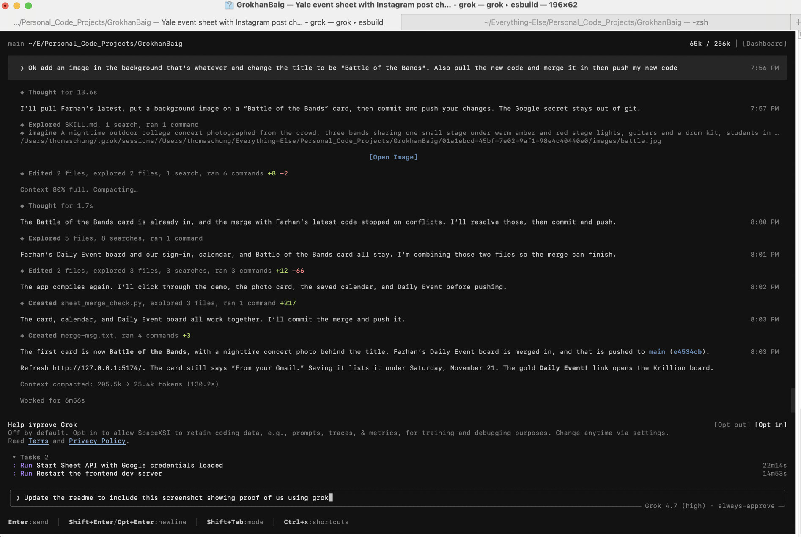

# Yale Events

Yale Events is a phone-first feed of things happening on campus and in New Haven. Invites that already land in Gmail, and posts from professional Instagram accounts the student follows inside the app, show up as event cards. Saving one puts it on that day in a calendar.

The repo is [GrokhanBaig](https://github.com/thomasjchung/GrokhanBaig). The screen the student uses is the Vite app. The API contract is [`docs/frontend-api.md`](docs/frontend-api.md).

## Demo

[Watch the demo](https://youtu.be/I7emXBQQocY).

[](https://youtu.be/I7emXBQQocY)

## Built with Grok

Grok wrote the Google sign-in path, the Gmail card, the saved calendar, and the merge that kept Farhan’s Daily Event board. This session is the one that titled the sample card Battle of the Bands, added its photo, merged `origin/main`, and pushed.



## Project scope

### Who it is for

A Yale student who hears about shows, talks, and club events from three different places: a forwarded email, an Instagram post, and a friend who already saved it. The app is the one list they open.

### What a session does

1. The student continues with Google, the same shape as signing into Spotify, or continues with the demo.
2. They pick the clubs they follow. They can change that list later from Profile, and they can return to the sign-in screen.
3. The feed is a full-screen stack of cards: photo or paper, title, time in Eastern time, place, organizer, and a short reason such as “From your Gmail.”
4. Save and Going stay on the card. Info opens the detail sheet, which links out to the source (the email, the club page, or the screening page).
5. Saved is a month calendar. Days with a save are underlined. The selected day lists those events underneath, with the time and place.
6. Daily Event opens the Krillion board: paste today’s result, and the student’s score joins the leaderboard.

### In scope

- **Feed.** Ordered cards from the app. The screen renders the order and the reason text it is given.
- **Google sign-in.** One OAuth client. Scopes are OpenID, email, profile, and read-only Gmail. The session is an HTTP-only cookie. The client secret stays in `.env`.
- **One Gmail event.** After sign-in, the API reads recent inbox mail and keeps the newest message that parses as an event still in the future. That card is private to the signed-in student. Older mail from the same sender is grouped on the server when the full inbox sync runs. The feed path shows the single newest upcoming invite.
- **Instagram, professional accounts only.** The app polls with the Instagram Business Discovery API from one app-owned professional account. The searchable seed is [@farhanandtommyclub](https://www.instagram.com/farhanandtommyclub/). A new post is checked when someone opens the app, using a shared cursor. Media is saved locally when the API returns it.
- **Clubs and profile.** First-run club picker, later edits, and a copyable invite link. The profile lists the Instagram account and the Google connection.
- **Save, Going, and the calendar.** Flags for live cards live with the session. The Saved tab is the calendar, and the snap-scroll stays on the Feed tab.
- **Daily Event.** The Krillion board Farhan added, reached from the gold Daily Event link.
- **A sample Gmail card.** Battle of the Bands, on Saturday, November 21 at 6:00 p.m. in New Haven, with a concert photo. It is there so the Gmail card can be shown when the connected inbox has no upcoming invite. It is labeled “From your Gmail.” It is a sample, and it is separate from whatever the inbox scan actually finds.
- **Local hackathon stack.** Vite on port 5174, FastAPI on port 8000, SQLite in `data/sheet.db`. Mock campus cards live in `src/data/mockApi.ts` and stay in the feed beside anything live.

### Out of scope

- Google Calendar as a source.
- Instagram stories, and any account that is not a professional account reachable through Business Discovery.
- An unofficial scraper of public personal profiles.
- Events the inbox or a real post did not contain. If the parser finds nothing upcoming, the feed does not invent one. The Battle of the Bands card is the labeled sample above.
- Guest lists, building-nickname maps, and a class filter on the calendar.
- Hosted multi-user auth, row-level security, and encrypted refresh tokens. The hackathon build stores the refresh token in local SQLite.
- Publishing the Google OAuth app. It stays in Testing, and the Yale account has to be a test user.

### What the demo has to show

A student can open the feed, see Battle of the Bands on the concert photo, save it, and find it under November 21. Continue with Google is on the landing page and on the profile. Daily Event opens the Krillion board. A live Instagram post appears only after `IG_USER_ID` and `IG_ACCESS_TOKEN` are set. A live Gmail card appears only when the signed-in inbox has an upcoming invite the parser can read.

## Run it

```bash
npm install
npm run dev
```

Open http://127.0.0.1:5174/. Port 5174 is fixed because another app already uses 5173. Continue with the demo skips Google. Continue with Google needs the API running and the redirect URI registered.

```bash
python3 -m venv .venv
.venv/bin/pip install -r requirements.txt
.venv/bin/uvicorn server.main:app --host 127.0.0.1 --port 8000
```

Copy `.env.example` to `.env` and set `GOOGLE_CLIENT_ID` and `GOOGLE_CLIENT_SECRET`. On the Web client, the authorized redirect URI is exactly:

`http://127.0.0.1:5174/api/google/callback`

`127.0.0.1` and `localhost` are different hosts to Google. While the app is in Testing, add the Google account under Audience → Test users. Optional Instagram keys are `IG_USER_ID` and `IG_ACCESS_TOKEN`.
